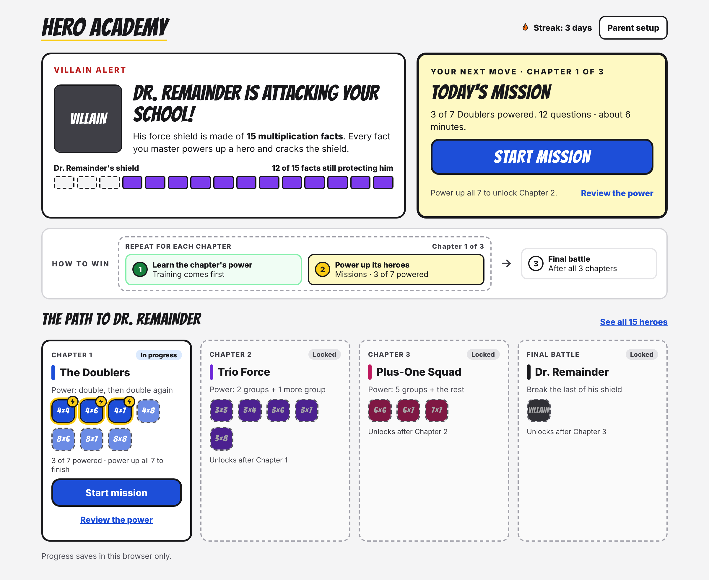
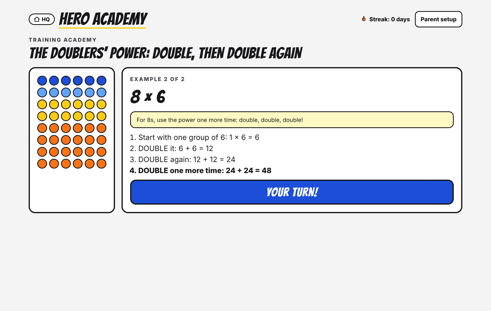
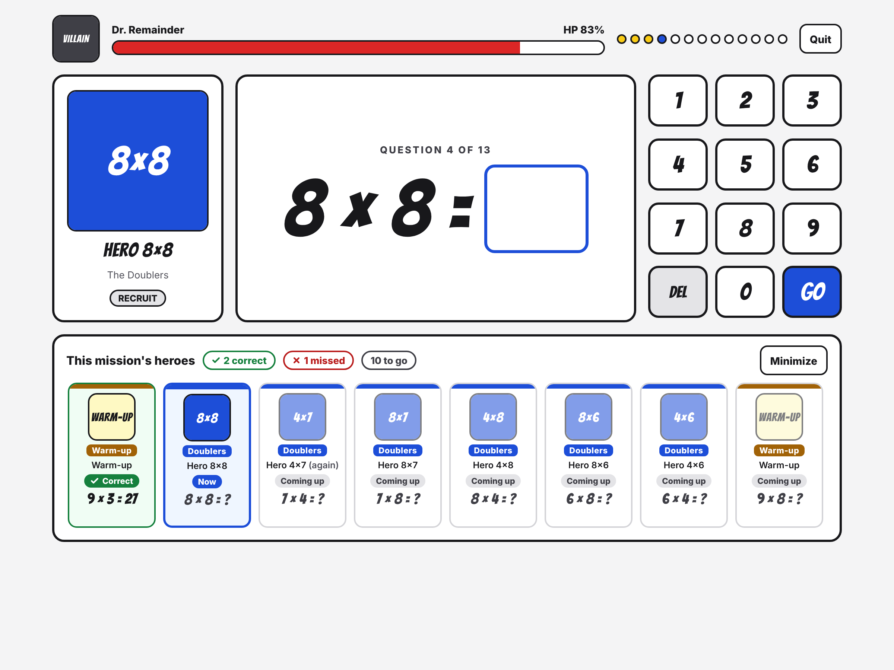
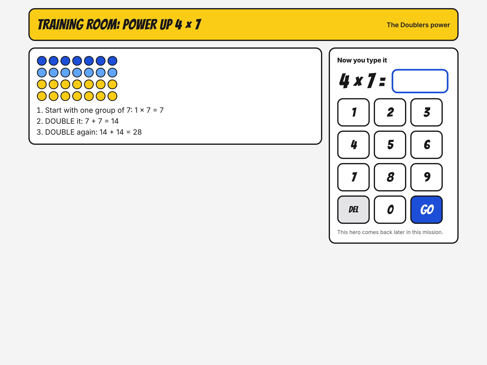
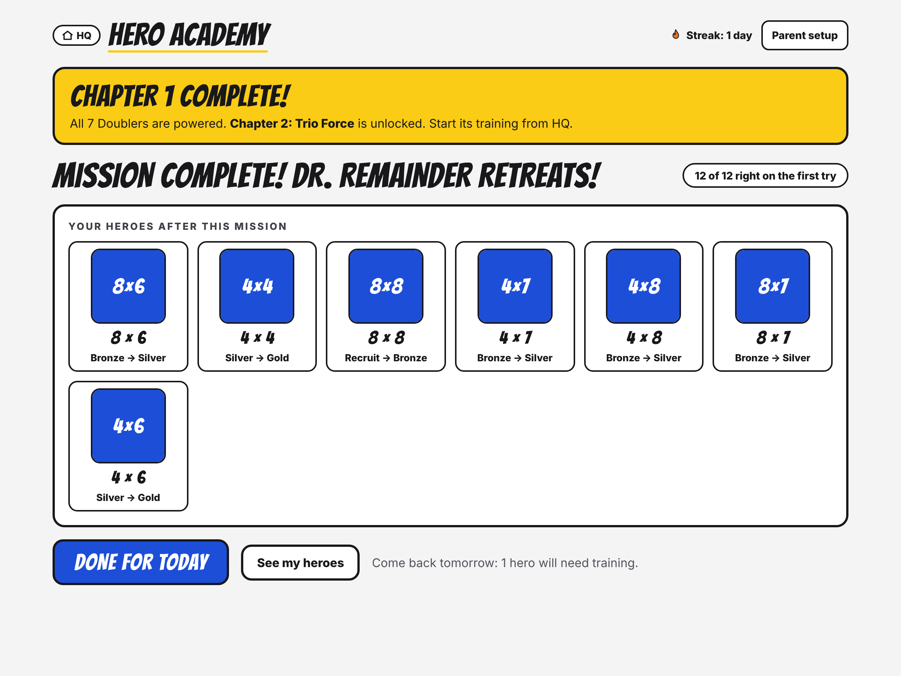
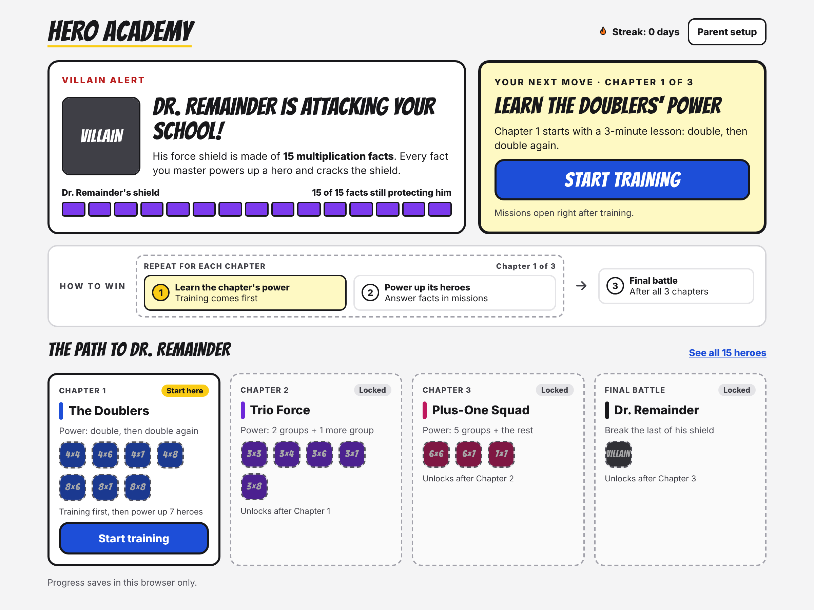
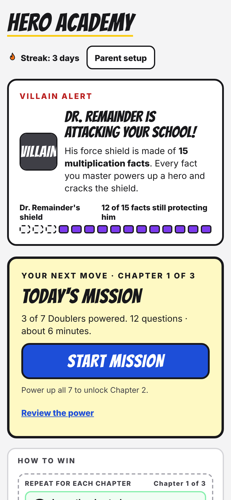

# Hero Academy

**A research-based multiplication game for kids who still count on their fingers.**

I built Hero Academy for my 8-year-old, a third grader who knew his 1s, 5s, 9s, 10s and 11s but still counted up to solve anything with a 3, 4, 6, 7 or 8. Instead of another flashcard app, I started from the research on how children actually become fluent with math facts, then wrapped it in a superhero story he'd want to come back to every day.

**▶ Play it:** https://spkrause-maker.github.io/hero-academy/



## The idea in one paragraph

A villain's force shield is made of the **15 multiplication facts** a child has left to learn. Each fact is a hero. The heroes are grouped into three teams, and each team's "superpower" is a real mental-math strategy: *double, then double again* for 4s and 8s; *2 groups + 1 more* for 3s; *5 groups + the rest* for 6s and 7s. Kids learn a power in a short lesson, then use it in daily 6-minute missions to power up that team's heroes. Every fact mastered cracks the shield, and when all 15 heroes are powered, it's time for the final battle.

## Screenshots

The heroes below show the built-in placeholder badges. Families add their own pictures and names in Parent setup.

| | |
|---|---|
|  |  |
| **Training lesson.** Each chapter teaches its strategy first. Here, 8 × 6 by doubling three times. | **Mission.** Answers are typed from memory. The strip below tracks every hero in the mission. |
|  |  |
| **Training Room.** A miss shows the strategy, then the child types the right answer. | **Debrief.** Rank changes for each hero, and a banner when a chapter is finished. |
|  |  |
| **First visit.** One next move: learn the first power. | **Phone.** The main button sits above the fold. |

## What the research says, and what the game does about it

| Research finding | Design decision |
|---|---|
| **Retrieving** an answer from memory builds fluency better than re-reading or chanting, including for multiplication facts | Every answer is typed from memory. No multiple choice. |
| **Spacing** practice over days beats cramming | One short mission a day. Facts return on an expanding schedule: next day → 3 days → 1 week → ~3 weeks. |
| Kids go from **counting → deriving from known facts → recall**, and need the deriving strategies taught explicitly | Each chapter opens with a strategy lesson. A wrong answer shows the strategy as a dot grid, then the child types the right answer. |
| **Mixed practice** beats practicing one type at a time | Shuffled questions, flipped factors, and review of earlier chapters mixed into later ones. |
| **Timed practice** helps, but only once a child is accurate | No visible timer. Speed only matters for the top ranks (Gold = correct in under 3 seconds). |
| **Games** mostly boost motivation; their learning effects are small | The story drives daily practice; the learning comes from the mechanics above. |

The full write-up, with sources, caveats and the parts researchers still argue about, is in **[docs/RESEARCH.md](docs/RESEARCH.md)**.

## How it plays

1. **Learn the power.** A short lesson builds the strategy step by step with dot grids, then asks for one practice problem.
2. **Run missions.** 12 questions: 8 from the current chapter, up to 2 review facts from finished chapters, and 2 warm-ups. Misses go to the Training Room and come back later in the mission.
3. **Power up heroes.** Each hero ranks up from Recruit to Bronze, Silver, Gold and Legend.
4. **Finish the chapter**, unlock the next one, and eventually face the villain.

Parents can add a picture and name for every hero and the villain (drag-and-drop, paste or upload), set the "place under attack," and check a progress table showing each fact's rank, typical answer time and next review date.

Rules, screens and the design history are in **[docs/DESIGN.md](docs/DESIGN.md)**.

## Running it

It's a single HTML file with no build step and no dependencies.

- **Locally:** download `index.html` and open it in a browser. Progress saves in that browser.
- **GitHub Pages:** in the repo's Settings → Pages, choose "Deploy from a branch," pick `main` and `/ (root)`. The game will be live at `https://<your-username>.github.io/<repo-name>/`.

## Tests

An automated playthrough runs the whole game in a simulated browser: a fresh start, all three chapters, review questions appearing on later days, a miss after a chapter is finished, the final battle, and existing progress carrying over.

```bash
npm install
npm test
```

The tests also run on every push via GitHub Actions.

## Built with

Plain HTML, CSS and JavaScript. Designed and built through AI pair programming with Claude: research synthesis, wireframes, implementation and tests, iterated on through playtesting at home.

## License

[MIT](LICENSE). The game ships with no character artwork; pictures families add stay in their own browser or account.
